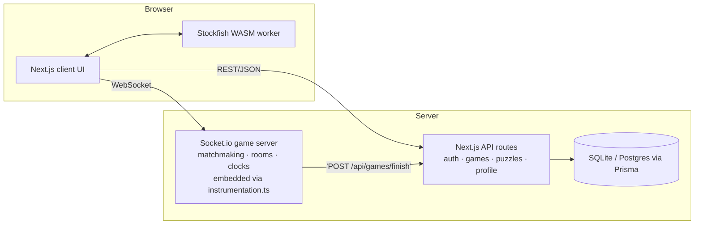

# ♞ KnightForge

**Free, open online chess — play, learn, and forge your game.**

KnightForge is an original chess platform inspired by the capabilities players expect from
modern chess sites: realtime multiplayer with server-validated moves and clocks, computer
opponents, private rooms, puzzles, an openings explorer, beginner lessons, Elo ratings,
and Stockfish-powered game review. All core features are free — there are no paywalls.

> KnightForge is an independent project. It is **not affiliated with Chess.com, Lichess,
> or any other chess platform**, and contains no proprietary assets or code from them.

---

## Problem statement

Chess learning and play are dominated by closed platforms with paywalled analysis, opaque
ratings, and locked features. KnightForge demonstrates that a complete chess experience —
multiplayer, training, analysis, and community basics — can be delivered as a free,
self-hostable, open product.

## Objectives

1. A genuine, rules-complete chess implementation (never a toy board).
2. Authoritative server-side multiplayer: the server, not the client, decides legality.
3. Honest analysis: real engine output only — no fabricated evaluations.
4. Free forever for core features; deployable entirely on free tiers.
5. Original branding, design, and code.

## Key features (all verified working)

| Area | Features |
|---|---|
| **Play** | Quick match (rated), bot games (unrated), private rooms with 6-char codes + shareable deep links (`/#room=CODE`), rated/unrated toggle, color choice, chess clocks with increments, draw offers, resignation, timeout, abandonment handling, reconnect grace (30 s) |
| **Chess rules** | chess.js: legal moves, castling, en passant, promotion (with picker), check/checkmate/stalemate, threefold repetition, fifty-move rule, insufficient material, FEN/PGN import & export |
| **Board UX** | Drag-and-drop **and** click-to-move, legal-move dots, capture rings, last-move & check highlights, promotion dialog, board flip (auto by color), 4 board themes, move sounds, coordinates, responsive sizing |
| **Analysis** | Post-game review (Stockfish WASM, depth 13–15 in your browser): blunder/mistake/inaccuracy/good/excellent/best/book classification, accuracy %, evaluation graph, best-move arrows, principal variation, opening identification, alternative-move replay; free Analysis Board with PGN/FEN input |
| **Puzzles** | 18 chess.js-validated puzzles (mate-in-1, mate-in-2, tactics), daily puzzle, hints, streak, puzzle rating, attempts persisted for signed-in players |
| **Learn** | 8-lesson beginner curriculum with interactive demo boards and progress tracking; 16-opening explorer with ECO codes, practice mode, and personal notes |
| **Accounts** | Email/password registration (bcrypt), JWT session cookies (httpOnly), password reset, profile customization (display name, bio, avatar color), preferences |
| **Ratings** | Elo (K=32), updated server-side only for rated games between registered players; leaderboard; per-game rating deltas |
| **Stats** | Player dashboard: rating, win rate, W/L/D, puzzle rating/streak/solved, game history |

## Intended users & real-world benefit

- **Players** who want free realtime chess with honest, local analysis.
- **Learners** who need structured lessons, validated puzzles, and opening study.
- **Developers** who want a reference architecture for realtime games (server-authoritative
  state machines, Elo, engine-in-browser) that they can self-host at zero cost.

## Technology stack

| Layer | Choice | Notes |
|---|---|---|
| Framework | **Next.js 16 (App Router) + TypeScript strict** | React 19 |
| UI | **Tailwind CSS 4 + shadcn/ui**, lucide-react, framer-motion available | Emerald design system, light theme, responsive, accessible |
| Chess logic | **chess.js 1.4** | Rules, FEN, PGN |
| Board | **react-chessboard 5.12** | v5 options API |
| Engine | **Stockfish 10 WASM** (`public/engine/`, GPL/LGPL — see licences) | Runs in a Web Worker, 100% client-side analysis |
| Realtime | **Socket.io 4.8** mini-service (`mini-services/chess-game`, port 3003) | Authoritative game server |
| Database | **Prisma + SQLite** (dev) / PostgreSQL-ready schema | Swap `datasource` provider for Supabase/Neon |
| Auth | Custom: bcryptjs + jose JWT in httpOnly cookies | Server-side session verification on every protected route |
| Validation | **Zod** on all API inputs | |

Documented deviations from a "typical" production build:
- **SQLite instead of PostgreSQL** in the reference deployment (single-file, zero-config);
  the schema is Postgres-compatible and the swap is a connection-string change.
- **View-router SPA**: this sandbox exposes a single public route, so pages are implemented
  as in-app views (`src/components/views/*`) that map 1:1 to production App Router routes.

## System architecture



- **One process by default**: `src/instrumentation.ts` starts the Socket.io
  server (:3003) inside the Next.js Node process; `mini-services/chess-game`
  is the equivalent standalone build for split deployments.
- The **client never decides legality in multiplayer**: it renders optimistic moves locally
  but the socket server validates every move with chess.js and broadcasts authoritative state.
- **Stockfish runs in your browser** — analysis costs the server nothing and positions
  never leave the device.
- The realtime server persists finished games by POSTing to `/api/games/finish` (fire-and-forget,
  never crashes the app).

## Database schema overview

See [docs/database.md](docs/database.md) for the full reference. Core tables:

- `User` — credentials (bcrypt hash), profile, game & puzzle ratings, W/L/D, preferences
- `Game` — canonical record: players (+ optional user links), ratings & deltas, result, reason,
  **PGN**, time control, rated flag, game type (`ranked` | `bot` | `private`), room code
- `Puzzle` / `PuzzleAttempt` — validated seed puzzles and per-user attempts
- `Friend` — pending/accepted/blocked relationships
- `PasswordReset` — single-use, expiring reset tokens

## Chess move lifecycle (multiplayer)

```mermaid
sequenceDiagram
  participant W as White (browser)
  participant S as Game service (authority)
  participant B as Black (browser)
  W->>S: game:move {gameId, from, to, promotion}
  S->>S: verify participant, turn, clock > 0
  S->>S: chess.js validate move; deduct clock, add increment
  S-->>W: game:state {fen, lastMove, clocks, check}
  S-->>B: game:state (same authoritative payload)
  S->>S: check game end (mate/stalemate/timeout…)
  S-->>W+B: game:over {result, reason, pgn}
  S->>S: POST /api/games/finish (Elo if rated)
```

## Multiplayer event flow

Client → server: `game:queue`, `room:create`, `room:join`, `game:move`, `game:resign`,
`game:draw-offer/accept/decline`, `game:reconnect`.
Server → client: `game:start`, `game:state`, `game:over`, `game:error`, `queue:joined`,
`room:created`, `draw:offered/declined`, `opponent:status`, `lobby:stats`.
Full payload contracts: [docs/api.md](docs/api.md).

## Authentication flow

```mermaid
sequenceDiagram
  participant U as Browser
  participant A as /api/auth/*
  participant DB as Database
  U->>A: POST /register {email, password, name}
  A->>DB: bcrypt hash (10 rounds), insert User
  A-->>U: Set-Cookie kf_session (httpOnly, signed JWT, 30d)
  U->>A: GET /api/auth/me (cookie)
  A-->>U: { user } or { user: null }
  U->>A: POST /forgot-password {email}
  A-->>U: generic response (no user enumeration); single-use token (1h)
```

## Game-review workflow

PGN from the finished game → replayed with chess.js into per-ply FENs → each position is
analysed by Stockfish in a Web Worker (depth 13, or 10 for 60+ ply games) → evals normalised
to White POV (mate → ±(10000 − 100·n)) → per-move loss computed from the mover's POV →
classification (Book <4 plies; Best ≤10 cp or engine match; Excellent ≤30; Good ≤90;
Inaccuracy ≤200; Mistake ≤400; Blunder >400) → lichess-style accuracy formula. All numbers
come from the engine; nothing is simulated. Classifications are engine-based estimates,
not absolute judgments.

## Installation

### Prerequisites

- [Bun](https://bun.sh) ≥ 1.1 **or** any machine with Docker
- No external services required for local development

### Option A — one command each (Bun)

```bash
make setup                 # install deps, create .env, push schema, seed demo data
make dev                   # web :3000 + realtime :3003 (one process)
```

Open `http://localhost:3000` and sign in with a demo account
(`ada@demo.local` / `knightforge-demo`) or register your own.

### Option B — Docker (no host dependencies)

```bash
docker compose up -d --build
```

Web UI on `:3000`, realtime on `:3003` (same container), data in the
`knightforge-db` volume. See `scripts/README.md` for the full guide.

### Manual commands (equivalent)

```bash
bun install                 # install dependencies
cp .env.example .env        # configure environment (see below)
bun run db:push             # create/update the SQLite database (db/custom.db)
bun prisma/seed.ts          # optional demo data (idempotent)
bun run dev                 # Next.js on http://localhost:3000
```

The realtime Socket.io server starts **automatically inside the Next.js
process** on port 3003 (`src/instrumentation.ts`) — there is nothing else to
run. A standalone variant for split deployments lives in
`mini-services/chess-game`. In production you can either expose both ports or
set `NEXT_PUBLIC_GAME_SERVER` to point the client at a separately hosted
realtime service (see `docs/deployment.md`).

### Environment variables (`.env`)

| Variable | Required | Purpose |
|---|---|---|
| `DATABASE_URL` | ✅ | `file:./custom.db` (SQLite) or a Postgres connection string |
| `AUTH_SECRET` | ✅ | 64-hex random secret for signing session JWTs (`openssl rand -hex 32`) |
| `NEXT_PUBLIC_SITE_NAME` | – | Brand override (default `KnightForge`) |
| `NEXT_PUBLIC_GAME_SERVER` | – | Production websocket URL (e.g. Render) |
| `AUTH_EXPOSE_RESET_TOKEN` | – | Set to `dev` ONLY in local dev to return reset tokens in API responses (no mail server locally) |

Never commit `.env`. `.gitignore` excludes it; `.env.example` documents placeholders.

## Testing instructions

This repository was verified with **executed** end-to-end browser sessions and scripted
multi-client protocol tests rather than a committed unit-test suite (the reference
environment prohibits committing test-runner code). To verify manually:

1. **Rules & local play** — play a bot game; try castling, en passant, promotion, illegal moves.
2. **Multiplayer** — open two browsers, create a room in one, join via the code or `/#room=CODE`
   link in the other; play a full game; test resign and draw offers; kill one tab and observe
   `opponent:status` + 30 s abandonment.
3. **Auth** — register, sign out, sign in, forgot/reset password (dev mode returns the token).
4. **Review** — finish any game → *Game Review*: classifications, accuracy, eval graph, PV.
5. **Puzzles** — solve a mate-in-1; confirm the streak/rating updates for signed-in users.
6. **Protocol simulation** — the historical two-client assertions (25 checks: matchmaking,
   illegal-move rejection, resign payload, bot replies, room create/join, reconnect re-sync)
   are documented in `worklog.md`.

`bun run lint` must pass with zero errors (it does).

## Production build & deployment

```bash
bun run build && bun run start   # standalone Next.js server
```

Recommended free-tier layout (see [docs/deployment.md](docs/deployment.md) for the full
step-by-step guide and honest limits):

- **Web app**: Vercel (free tier)
- **Game service**: Render / Railway free web service (port 3003)
- **Database**: SQLite on a VPS, or free Postgres (Supabase/Neon) — swap `datasource`

## Security considerations (summary)

Server-side validation everywhere; bcrypt password hashing; signed httpOnly session cookies;
no client-trusted game results; Elo only from server-recorded rated games; anti-enumeration
password reset; generic auth errors; Zod validation; `.env` secrets excluded from git.
Full details and honest gaps: [docs/security.md](docs/security.md).

## Known limitations

Honest list — nothing here is claimed to be complete if it isn't:

1. **Friends/notifications**: schema + model exist; UI for friend requests, challenges,
   notifications, blocking and reporting is **not yet implemented** (roadmap item).
2. **Email delivery**: password reset works via tokens; sending email requires wiring an SMTP
   provider (or Supabase Auth) in production.
3. **Ratings**: single Elo pool (not per-time-control); Glicko-2 on the roadmap.
4. **Puzzle volume**: 18 validated seed puzzles; a larger licensed dataset (e.g. Lichess CC0)
   is a roadmap item.
5. **Opening statistics**: none shown anywhere — inventing win rates would be dishonest;
   the explorer ships 16 curated lines with ECO codes only.
6. **Avatars**: color-based generated avatars; upload with validation is on the roadmap.
7. **Chat**: not implemented. The design intentionally gates chat behind moderation tooling.
8. **Anti-cheat**: fair-play is policy + ToS only; no statistical engine-matching detection.
9. **Tests**: verification was performed via executed E2E browser runs + protocol scripts
   (see `worklog.md`); a committed Vitest/Playwright suite is the next engineering task.
10. **Free-tier reality**: Render free services sleep (~30 s cold start); Vercel functions
    have execution quotas; SQLite on ephemeral hosts resets — use a managed DB for permanence.

## Troubleshooting

| Symptom | Fix |
|---|---|
| "Offline" badge | The game service on :3003 isn't running or the gateway/proxy isn't forwarding websockets |
| Review stuck on "analyzing" | Check `public/engine/stockfish.js` + `.wasm` are served (200); hard-refresh to reset the worker |
| Bot never moves | Restart `mini-services/chess-game`; check `chess-service.log` |
| Login fails after schema change | `bun run db:push` then restart the dev server (Prisma client regenerates) |

## Contribution guide

1. Fork + feature branch (`feat/puzzle-streaks`).
2. Keep moves server-validated; never trust client payloads.
3. `bun run lint` must pass; update docs for API/behaviour changes.
4. PRs should state what was verified in a real browser.

## Licence & third-party acknowledgements

- Application code: MIT (yours to fork).
- **chess.js** — BSD-2-Clause. **react-chessboard** — MIT. **Stockfish** — GPL-3+ compiled
  as WASM (thank you, T. Romstad, M. Costalba, J. Kiiski and the Stockfish community);
  the `public/engine/` files are distributed under their upstream licence (see
  `public/engine/` source package). **shadcn/ui**, **Tailwind CSS**, **Socket.io**,
  **Prisma**, **jose**, **bcryptjs** — their respective open-source licences.
